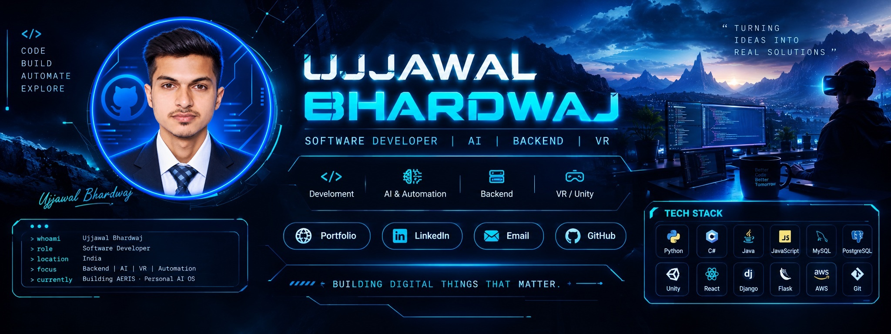

<div align="center">

<!-- NEURAL CORE custom visual identity -->



### `Building digital things that matter.`

**Software Developer** · Backend Engineering · AI & Automation · VR Development

[](https://bhardwaj-0001.github.io/my-portfolio/)
[](https://linkedin.com/in/ujjawalbhardwaj-in)
[](mailto:bhardwajujjawal07@gmail.com)
[](https://github.com/BHARDWAJ-0001)


</div>

---

## `01 / NEURAL CORE // DEVELOPER PROFILE`

```text
┌─ UJJAWAL@DEV ───────────────────────────────────────┐
│  ROLE      : Software Developer                     │
│  FOCUS     : Backend · AI · Automation · VR         │
│  BUILDING  : AERIS — Personal AI Operating System   │
│  WORKING   : Meta Quest VR Training Simulations     │
│  LOCATION  : India                                   │
└─────────────────────────────────────────────────────┘
```

I'm a Software Developer with an MCA background and experience building backend systems, RESTful APIs, database-driven applications, AI-powered tools, and interactive software. I enjoy taking ideas from concept to working applications, with a focus on practical functionality, maintainability, and reliable engineering.

- **Current role:** Software Developer at Experience Zone, Ranchi.
- **VR development:** Unity/C# applications for Meta Quest/Oculus, including a VR-based mining traffic safety training simulation for Northern Coalfields Limited (NCL).
- **AI & automation:** Agent workflows, voice interaction, persistent memory, computer vision, OCR, and desktop automation through **AERIS**.
- **Education:** Master of Computer Applications (MCA), Galgotias University.

### Engineering interests

`AI Agents` `Backend Systems` `REST APIs` `Desktop Automation` `VR Applications` `Machine Learning` `System Design`

---

## `02 / ACTIVE MISSION`

<div align="center">

| `01` | `02` | `03` |
|:---:|:---:|:---:|
| 🤖 **Build intelligent tools** | ⚙️ **Engineer reliable systems** | 🥽 **Create immersive experiences** |
| AERIS, agent workflows and automation | APIs, databases and application logic | Unity/C# simulations for Meta Quest |

</div>

### Software Developer · Experience Zone

**March 2026 – Present** · Ranchi, India

Developing VR applications for Meta Quest/Oculus using Unity and C#.

- Developing a VR-based training simulation for **Northern Coalfields Limited (NCL)** focused on mining traffic operations and safety training.
- Writing and debugging C# scripts for VR interactions, application logic, and features.
- Building, testing, and packaging Unity projects into APKs for Meta Quest.
- Troubleshooting and refining application functionality during development and testing.
- Collaborating with the development team to improve application behavior and reliability.

---

## `03 / FLAGSHIP SYSTEM`

### 🤖 AERIS — Personal AI Operating System

> A modular, voice-first Personal AI Operating System exploring AI reasoning, desktop automation, intelligent task execution, persistent memory, and system awareness.

AERIS explores how an AI system can move beyond conversation into a controlled execution layer that understands tasks, discovers tools, interacts with the environment, and performs actions with verification and recovery.

<details>
<summary><strong>🧠 AI reasoning & agent execution</strong></summary>

- Modular, tool-driven agent execution framework
- Dynamic action discovery
- Permission and confirmation workflows
- Controlled tool execution
- Audit logging and undo capabilities

</details>

<details>
<summary><strong>🔄 Observe → Act → Verify → Recover</strong></summary>

- Task orchestration built around observation, action, verification, and recovery
- Recovery workflows for failed or interrupted actions
- Runtime-aware execution

</details>

<details>
<summary><strong>🖥️ Desktop automation & persistent memory</strong></summary>

- Browser control, file management, reminders, and workflow execution
- Proactive task execution and routine detection
- Local persistent memory using SQLite
- Full-text search, context-aware interactions, and long-term information management

</details>

<details>
<summary><strong>👁️ Computer vision & voice-first interaction</strong></summary>

- Screen understanding, OCR, visual context processing, and environmental awareness
- Voice interaction and custom wake-word detection
- Natural task execution through voice commands

</details>

<details>
<summary><strong>🎛️ Command center, security & testing</strong></summary>

- PyQt6 command center for system telemetry, task monitoring, voice interaction, AI visualization, and centralized control
- Encrypted secrets management, capability controls, rate limiting, isolated code execution, recovery workflows, and audit trails
- The original project notes report **100+ automated tests** across AI functionality, automation, memory, security, and runtime behavior

</details>

**Tech stack**

`Python` `Google Gemini Live API` `PyQt6` `SQLite` `Computer Vision` `OCR` `AI Agents` `Automation`

---

## `04 / PROJECT LAB`

<table>
<tr>
<td width="50%" valign="top">

### 🥽 VR Training Simulations

Immersive VR training workflows built with Unity and C# for Meta Quest/Oculus, including mining traffic operations and safety scenarios for NCL.

**Focus:** `Unity` `C#` `Meta Quest` `Oculus` `VR Interactions` `APK Packaging`

</td>
<td width="50%" valign="top">

### 📚 Hybrid Book Recommendation

A Flask-based recommendation platform combining content-based and collaborative filtering to generate personalized book recommendations.

- KNN, SVD, and cosine similarity
- Processed **1M+ user ratings** using Pandas and NumPy
- RESTful endpoints for search, favorites, and recommendations
- Project notes report a **25% improvement in precision/recall** compared with standalone models

**Stack:** `Python` `Flask` `Scikit-learn` `Pandas` `NumPy` `REST API`

</td>
</tr>
<tr>
<td width="50%" valign="top">

### 🌍 Tour & Travel Management

A full-stack booking application for hotels, flights, trains, and buses, with payment processing described in the original project notes.

- Booking workflows for multiple travel services
- Normalized MySQL schema for users, bookings, and inventory
- Backend authentication and booking logic
- Responsive frontend integrated with backend services

**Stack:** `PHP` `MySQL` `JavaScript` `HTML5` `CSS3` `Bootstrap`

</td>
<td width="50%" valign="top">

### 🌐 Developer Portfolio

A personal portfolio showcasing projects, technical experience, and my development journey.

**[Explore portfolio →](https://bhardwaj-0001.github.io/my-portfolio/)**

</td>
</tr>
</table>

---

## `05 / TECHNICAL ARSENAL`

| Domain | Technologies & concepts |
|---|---|
| **Programming** | `Python` `C#` `Java` `JavaScript` `PHP` |
| **Backend & APIs** | `Django` `Flask` `RESTful APIs` `Django Templates` `Form Handling` `AJAX` |
| **Frontend** | `HTML5` `CSS3` `JavaScript` `React.js` `Bootstrap` `Responsive Web Design` |
| **Databases** | `MySQL` `SQL` `SQLite` `Database Design & Optimization` |
| **AI & Automation** | `AI Agents` `LLM Integration` `Tool Calling` `Gemini Live API` `Computer Vision` `OCR` `Voice Interfaces` `Desktop Automation` |
| **Machine Learning** | `Scikit-learn` `Pandas` `NumPy` `KNN` `SVD` `Cosine Similarity` `Content-Based Filtering` `Collaborative Filtering` |
| **VR & Application Development** | `Unity` `C# Scripting` `Meta Quest` `Oculus` `.NET` |
| **Tools & Platforms** | `Git` `AWS` `Visual Studio` `Jupyter` `Google Colab` |

<div align="center">


</div>

---

## `06 / COMPUTER SCIENCE`

| Area | Focus |
|---|---|
| 🧩 Data Structures & Algorithms | Problem solving |
| 🏗️ Object-Oriented Programming | OOP principles and design |
| 🗄️ DBMS | Database management |
| 🌐 Computer Networks | Networking fundamentals |
| ⚙️ Software Engineering | Application development |
| 🏛️ System Design | Architecture and scalability |

---

## `07 / GITHUB TELEMETRY`

<div align="center">


</div>

---

## `08 / CONTRIBUTION MATRIX`

<div align="center">


</div>

<sub>Note: The contribution snake requires a GitHub Actions workflow to generate and publish `output/github-contribution-grid-snake.svg`.</sub>

---

## `09 / EDUCATION & CERTIFICATIONS`

### 🎓 Master of Computer Applications (MCA)
**Galgotias University, Greater Noida** · September 2023 – July 2025

### 📜 Certifications

- **Introduction to Big Data** — NPTEL IIT/IISc · October 2024
- **Web Full Stack Development Intern** — AICTE Eduskills · December 2024
- **Java Full Stack Developer Intern** — AICTE Eduskills · September 2024
- **Android App Development Using Kotlin** — EduPyramids, SINE IIT Bombay · June 2024

---

## `10 / CURRENT INTERESTS`

```text
AI & Intelligent Systems  ████████████████████
Backend Engineering       ████████████████████
Automation                ██████████████████
VR Development            █████████████████
Full-Stack Development    ████████████████
Machine Learning          ███████████████
System Design             ███████████████
```

I'm especially interested in AI-powered applications, tool-driven agents, intelligent desktop automation, voice interfaces, backend systems, REST APIs, database architecture, VR simulations, machine learning, and software design.

---

<div align="center">

## `LET'S BUILD SOMETHING USEFUL.`

Open to conversations about software engineering, AI, automation, backend systems, and immersive technology.

[](mailto:bhardwajujjawal07@gmail.com)
[](https://linkedin.com/in/ujjawalbhardwaj-in)
[](https://bhardwaj-0001.github.io/my-portfolio/)
[](https://github.com/BHARDWAJ-0001)


<sub>Designed with intent · Ujjawal Bhardwaj</sub>

</div>
